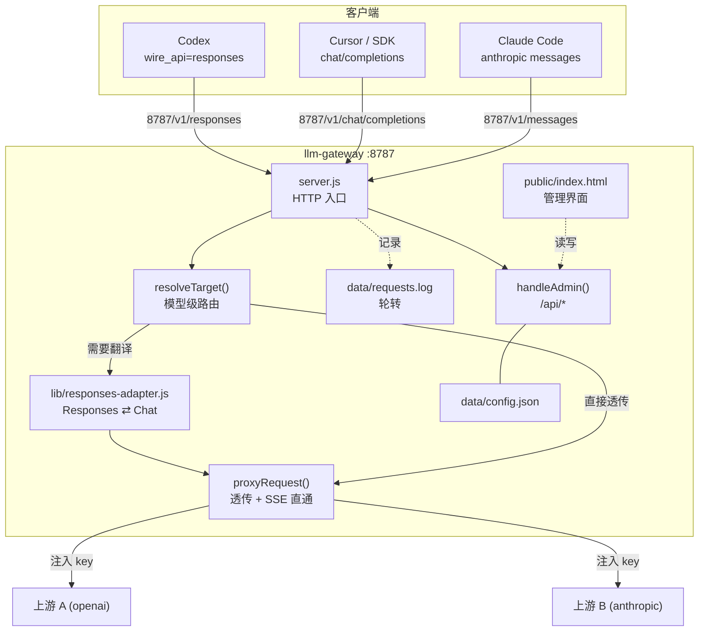

# LLM Gateway · 项目知识图谱（维护手册）

> 面向"接手这个项目的人/AI"。读这一份就够了：它是代码结构与设计决策的索引，
> 而不是使用说明（使用说明见 [README.md](./README.md)）。
>
> **维护纪律**：任何改动都必须同步更新本文件的「变更历史」与相关章节，并提交 git。

- 当前版本：**v1.8.0**（见 `package.json`）
- 仓库：https://github.com/Linix0/llm-gateway （Public / main / MIT）
- 运行时：Node >= 18，**零第三方依赖**（只 `require` 内置模块）
- 本机路径：`C:\Users\Administrator\WorkBuddy\2026-10-22-14-09-51\llm-gateway`

---

## 1. 它解决什么问题

把 Codex / Cursor / Claude Code / 任意 OpenAI 兼容客户端统一指向 `http://127.0.0.1:8787`，
上游用哪家、用哪把 key、用哪个模型，全部在网关上切换，客户端配置一次就不动。

两件别人做不了的事：

1. **协议适配**：Codex 0.16x 只支持 `wire_api="responses"`，而多数中转只有 `/v1/chat/completions`。
   网关实时把 Responses 请求翻译成 chat（含流式事件、工具调用），再把结果翻回 Responses。
2. **模型由网关决定**：客户端传什么模型名都无所谓，实际用哪个模型在网关界面上选。

---

## 2. 架构总览



**关键约束**：只监听 `127.0.0.1`（`config.server.host`）。不代理 WebSocket，不做鉴权，
不要把 host 改成 `0.0.0.0` 后暴露到局域网。

---

## 3. 文件地图

| 文件 | 行数级 | 职责 | 改这里要注意 |
|---|---|---|---|
| `server.js` | ~1140 | 全部服务端逻辑：配置、路由、代理、适配调度、管理 API、日志 | 已偏大，新增模块优先放 `lib/` |
| `lib/responses-adapter.js` | ~490 | Responses ⇄ chat/completions 双向翻译；导出 `toChatRequest` / `chatToResponses` / `streamChatToResponses` | 改流式事件序列时，务必用真实 `codex exec` 验证 |
| `public/index.html` | ~1900 | 单文件管理界面（HTML+CSS+JS 全内联，无构建）。**侧边导航布局**：左栏 `.sidebar`（品牌/导航/状态/模型胶囊），右栏 `.main` 内四个分页 `.page#page-{overview,providers,snippets,logs}`，由 `showPage(id)` 切换（localStorage + URL hash 记忆）。帮助释意 = 标题旁 `.help-btn`（data-help）→ `HELP` 映射 → 全局浮层 `.help-pop` | 主题用 CSS 变量；新增卡片要带 `data-cid` 以接入折叠体系；新增分页要同时加导航项和 `.page` 段 |
| `data/config.json` | — | 运行配置（**gitignore，含明文 key**） | 只能由 `saveCfg()` 写，勿手改（会被原子写覆盖） |
| `data/config.example.json` | — | 脱敏样例，入库 | 新增配置字段时**必须同步** |
| `data/requests.log[.N]` | — | JSONL 请求日志，按大小轮转 | gitignore |
| `autostart.ps1` | — | 注册/启停 Windows 计划任务 `LlmGateway` | 沙箱里 `schtasks.exe` 被禁，用 `Start-ScheduledTask` cmdlet |
| `start-hidden.vbs` | — | 由计划任务调用，无窗口启动 node | gitignore（含本机绝对路径） |

### server.js 内部索引（行号会漂移，按函数名定位）

| 区块 | 关键函数 | 说明 |
|---|---|---|
| 配置 | `loadCfg()` / `saveCfg()` / `resolveKey()` / `maskKey()` | `saveCfg` 是**原子写**（tmp → .bak → rename） |
| 日志 | `localIso()` / `rotateLogs()` / `logRequest()` / `logFiles()` | 时间存本地时区 + 毫秒 `at`；超 `maxSizeKB` 轮转 |
| 用量 | `loadUsage()` / `recordUsage()` / `extractUsage()` / `usageToTokens()` | 从响应尾部 8KB 抠 usage（OpenAI/Anthropic 字段名都兼容）；5s 合并落盘 `data/usage.json` |
| 并发 | `laneOf()` / `acquireLane()` / `releaseLane()` / `withLane()` | 每 provider 一条串行车道；排队可取消；详见 §7 决策表 |
| 路由 | `pickProvider()` / `mapModel()` / `resolveTarget()` / `reconcileActiveModel()` | `providerId/modelId` 显式路由优先级最高 |
| 代理 | `proxyRequest()` / `forwardHeaders()` / `readBody()` | SSE 边收边转；请求体上限 64MB |
| 适配 | `handleResponsesProxy()` / `sseWrite()` | 调用 `lib/responses-adapter.js` |
| 管理 | `handleAdmin()` | 所有 `/api/*` 端点都在这里，是一个大 `if` 链 |
| 测活 | `testProvider()` / `testModel()` | 后者发真实请求（`max_tokens=1`） |
| 测活持久化 | `recordModelStatus()` / `saveModelStatus()` / `runAutoTest()` / `scheduleAutoTest()` | 结果落盘 `data/model-status.json`（3s 合并原子写）；定时测活只在对应上游空闲时跑 |
| 生命周期 | `trackRequest()` / `shutdown()` | 优雅退出：停收新请求 → 等在途 → 退出 |

---

## 4. 请求生命周期

1. `createServer` 收到请求 → `trackRequest(res)` 计数在途
2. `/healthz` → 直接返回；`/api/*` → `handleAdmin()`；`GET /v1/models` → `listModels()`（本地声明）
3. `GET` 且非模型路径 → 静态文件（`serveStatic`）
4. 非模型路径 → 404（**不要**把页面请求转发到上游）
5. `resolveTarget(clientModel, anthropic)` 选出 `{provider, model}`：
   - 显式 `providerId/modelId` → 精确命中
   - `modelPolicy='fixed'` → 一律用 `cfg.activeModel`
   - `modelPolicy='auto'` → 按客户端模型名找唯一声明者，找不到回落当前
6. `mapModel()` 应用 `models[].upstream` 重映射，并写回请求体
7. `/v1/responses` 且 provider 未声明 `upstreamResponses:true` → `handleResponsesProxy()` 走翻译
8. 否则 `proxyRequest()`：注入 `authorization` / `x-api-key`，转发，SSE 直通
9. 结束 → `logRequest()` 写 JSONL（路径/模型/状态/耗时，**不记 prompt 与 key**）

---

## 5. 配置契约（`data/config.json`）

```jsonc
{
  "server": { "host": "127.0.0.1", "port": 8787 },
  "active": "nextapi",              // 当前 provider id
  "activeModel": "deepseek-v4.1-flash",
  "modelPolicy": "fixed",           // fixed=忽略客户端模型名 | auto=跟随客户端
  "logs": { "enabled": true, "maxSizeKB": 2048, "keep": 3 },
  "autoTest": { "enabled": false, "intervalHours": 24 },  // 定时自动测活（1–168h）
  "limits": {
    "queue": true,              // 同 provider 串行排队（并发=1 的上游不再互撞 429）
    "queueTimeoutMs": 120000,   // 排队上限，超出返回 503 gateway_queue_timeout（5000–600000）
    "retry": {                  // 429/5xx/网络错误 的整请求重放，默认关（避免重复计费）
      "enabled": false, "maxAttempts": 2, "backoffMs": 800
    }
  },
  "providers": [{
    "id": "nextapi",
    "name": "NextApi",
    "api": "openai",                // openai | anthropic
    "baseUrl": "https://api.nextapi.store/v1",
    "auth": { "type": "bearer", "value": "env:NEXTAPI_API_KEY" },  // env:VAR 或明文
    "upstreamResponses": false,     // true=上游原生支持 /v1/responses，跳过翻译
    "models": [{ "id": "deepseek-v4.1-flash", "name": "…", "contextWindow": 128000, "upstream": "真实名" }]
  }]
}
```

边界（由 `clampNum` 强制）：`maxSizeKB` 64–524288；`keep` 1–20。
`env:VAR` 从 `process.env` 取，取不到视为空（不会报错，请求会以无 key 发出）。

---

## 6. 管理 API 契约

| 方法 | 路径 | 说明 |
|---|---|---|
| GET | `/healthz` | 健康 + `inFlight` + `shuttingDown` |
| GET | `/api/state` | 配置（key 脱敏）+ `runtime` |
| POST | `/api/providers` | 新增/更新（**key 留空 = 不修改**，别把掩码写回去） |
| DELETE | `/api/providers/{id}` | 删除 |
| POST | `/api/active` | `{"id":"..."}` 切换当前 |
| POST | `/api/test` | 只查 `/models` 列表，**不调用模型** |
| POST | `/api/test/model` | `{"provider","model"}` 真实调用测活 |
| POST | `/api/test/models` | `{"items":[...],"delayMs":1200}` 串行批量测活 |
| GET | `/api/test/status` | 持久化的测活结果 + `autoTest` 配置 |
| POST | `/api/test/auto` | `{"enabled":true,"intervalHours":24}` 定时自动测活 |
| POST | `/api/model` | 设置 `activeModel` |
| POST | `/api/policy` | `{"policy":"fixed"\|"auto"}` |
| GET | `/api/logs?limit=50` | 最近日志 |
| GET | `/api/logs/meta` | 容量 + 文件清单 |
| POST | `/api/logs/config` | 改轮转策略 |
| POST | `/api/logs/clear` | `{"archives":true}` 连归档删 |
| GET | `/api/logs/download?name=` | 下载（只匹配 `requests.log[.N]`） |
| GET | `/api/usage` | 用量：总额 + 按 provider/model 明细（请求数/失败/token/均耗时） |
| POST | `/api/usage/clear` | 用量清零 |
| POST | `/api/reload` | 重读 config.json |

测活 `kind`：`ok` / `rate`(429) / `auth`(401-403) / `missing`(404) / `reject`(400) / `upstream`(5xx) / `net`。

---

## 7. 设计决策与坑（**改动前必读**）

| 决策 | 原因 | 反直觉的地方 |
|---|---|---|
| 零依赖 | 免 `npm install`，拷走即用 | 不要为此引第三方包；要工具函数自己写 |
| 管理界面单文件内联 | 无构建、无静态资源目录依赖 | CSS 变量定义在 `:root` 与 `[data-theme=light]`，新增颜色必须用变量 |
| 不做自动重试 | 避免重复计费 | v1.6.0 起改为**默认关、可选开**：只在 429/5xx/网络错误且**尚未给客户端写过任何字节**时整请求重放，一旦开始流式输出绝不重试 |
| 每 provider 串行车道 | 上游普遍"并发=1"，透传会互撞 429 | 车道按 provider 隔离（一个上游卡死不影响别的）；排队中的请求客户端断开会立即取消，不会泄漏车位 |
| `proxyRequest`/`handleResponsesProxy` 返回 Promise | 供 `withLane` 排队与优雅退出感知完成 | **改这两个函数时必须保证所有分支（end/error/close/重试耗尽）都调用 `done()`**，否则车道永久泄漏——v1.6.0 开发中就因往已销毁的 res 写响应抛异常导致 done 不执行，已用 try/finally + `sendJson` 防御修复 |
| 日志不记 prompt/key | 安全 | 排障时只能看路径/状态/耗时 |
| `modelPolicy=fixed` 静默替换模型 | 用户不想在客户端改配置 | 逃生门是 `providerId/modelId` 显式写法 |
| 时间存本地时区 + `at` 毫秒 | 曾存 UTC 导致界面差 8 小时 | 解析用 `at`，不要用 `ts` 再算 |
| 编辑表单 key 留空=不修改 | 曾把 `sk-21a4****` 掩码写回覆盖真实 key | 任何"保存配置"路径都要遵守这条 |
| `reconcileActiveModel()` 必须传参 | 早期版本引用全局 `cfg` 触发 TDZ 崩溃 | 不要在 `loadCfg()` 里读全局 `cfg` |
| `GET /` 曾被当模型请求转发 | 静态判断漏了方法/前缀 | 现在有 `isModelPath()` 兜底 |
| 上游限流 | NextApi 账号为 **RPM=10 / 并发=1** | 密集测试会满屏 429，**不是网关 bug**；批量测活必须串行节流 |

### 环境坑（本机）

- `github.com:443` 全 IP 超时，只有 SSH:22 通 → 推送一律走 `git@github.com:...`，`gh auth login --web` 必失败。
- Git Bash 可能把中文参数按 GBK 编码发出导致上游 400/500 → 测试请求体写成 UTF-8 文件再 `--data-binary @file`。
- 沙箱内：`schtasks.exe` 与 `wscript` 被安全策略拦截；用 PowerShell 的 `Start-ScheduledTask` / `Stop-ScheduledTask`。
- 重启服务正确姿势：`Stop-Process -Id <pid> -Force` 后再 `Start-ScheduledTask -TaskName LlmGateway`
  （只 `Stop-ScheduledTask` 不会结束已运行的进程，pid 不变，新代码不生效）。

---

## 8. 常见维护任务（怎么做）

| 任务 | 做法 |
|---|---|
| 加一个新 provider | 界面「新增」即可；或改 `config.json` 后 `POST /api/reload`。改端口需重启 |
| 加一个管理 API | 在 `handleAdmin()` 的 `if` 链里加一段，返回用 `sendJson()`；同步本文件 §6 与 README |
| 加一个界面分区 | 复制 `.card` 结构并带 `data-cid`，即自动接入折叠/持久化；主题色用变量；如需独立成页，在 `#nav` 加 `data-page` 项并放 `.page` 段 |
| 新增加密/鉴权 | 在 `createServer` 入口做，注意别拦 `/healthz` |
| 拆 `server.js` | 按 §3 区块拆到 `lib/`，`require` 进来；保持零依赖 |
| 改 Responses 适配 | 改 `lib/responses-adapter.js`，用真实 `codex exec` 验证（纯对话 + apply_patch 工具调用两条路径） |

### 验证清单（改完必跑）

```bash
node --check server.js                     # 语法
curl --noproxy '*' http://127.0.0.1:8787/healthz
curl --noproxy '*' -X POST http://127.0.0.1:8787/v1/chat/completions \
  -H 'content-type: application/json' -H 'authorization: Bearer local' \
  --data-binary @/tmp/req.json             # {"model":"…","messages":[{"role":"user","content":"ping"}],"max_tokens":16}
```

界面用 headless Chrome 截图核对（暗/亮/窄屏三态）：

```
"C:/Program Files/Google/Chrome/Application/chrome.exe" --headless=new --no-proxy-server \
  --window-size=1280,2200 --screenshot=out.png "http://127.0.0.1:8787/?theme=dark"
```

> 截图属内部验证产物，看完即删，不要留在仓库或项目目录。

---

## 9. 变更历史

### v1.8.0 · 侧边导航布局、功能释意与 README 规范化

- **界面重构**：顶部栏 + 单页堆叠卡片 → 侧边导航布局。左栏 `.sidebar`（品牌、导航、状态、模型胶囊、
  版本信息），右栏 `.main` 占满视口，四个分页：总览（当前调用模型 + 用量统计）、供应商（列表 + 编辑器）、
  客户端接入、请求日志。`showPage(id)` 切换，localStorage + URL hash（`#providers` 等）记忆，支持深链接。
- **功能释意**：卡片/区块标题旁新增 `.help-btn`（?），点击弹出 `.help-pop` 浮层解释该功能；
  内容在 `HELP` 映射里（route/providers/editor/models/snippets/usage/logs 共 7 条）。
- 布局细节：供应商列表不再限高（`max-height:none`）；日志表 `max-height: calc(100vh-250px)` 撑满视口；
  内容区 max-width 1240px；≤920px 时侧边栏变顶部横排导航（`.nav` 可横向滚动）。
- 移除「全部折叠」按钮（分页后不再需要）；默认折叠集不再含 snip（接入页独占一屏，进入时强制展开）。
- **README 重写为开源项目规范**：去掉本机专属内容（"当前机器上的配置"、具体模型清单、本机路径），
  改为 特性/快速开始/接入客户端/配置/自启/API/项目结构/已知限制/License 结构，补 shields 徽章。

### v1.7.0 · 测活结果持久化与定时自动测活

- `recordModelStatus()`：每次测活结果落盘 `data/model-status.json`（3s 合并原子写）；
  `GET /api/test/status` 返回，界面启动时回填，重启后 chip 仍有着色。
- **定时自动测活**（`autoTest.enabled`，默认关）：每 `intervalHours`（默认 24h）把全部模型
  串行测一遍（1.2s 节流），**对应上游车道正忙时跳过**，不打扰正常流量；
  启动后 90s 先跑一次。界面供应商卡片底部有「定时测活」开关；`POST /api/test/auto`。
- 实测：自动测活一轮 9 模型全部入账（nextapi 5 OK / agentrouter 3 net / openrouter 1 OK）。

### v1.6.0 · 请求队列与可选重试

- **每 provider 串行车道**（`limits.queue`，默认开）：同 provider 的上游请求排队执行，
  并发=1 的上游（如 NextApi 免费档）不再互撞 429；不同 provider 车道互不影响。
- 排队上限 `limits.queueTimeoutMs`（默认 120s），超出返回 503 `gateway_queue_timeout`；
  排队期间客户端断开立即取消，不占车位。
- **可选重试** `limits.retry`（默认关）：仅当 429/5xx/网络错误且**尚未给客户端写过任何字节**
  时整请求重放（`backoffMs × attempt` 退避）；开始流式输出后绝不重试；客户端断开取消重试。
- `proxyRequest()` / `handleResponsesProxy()` 改为返回完成 Promise；所有结束分支调用 `done()`。
- 防御修复：`sendJson()` 对已销毁响应直接返回（曾因往断开的 res 写 502 抛异常，
  导致车道不释放——这是开发本版本时实测抓到的死锁）。
- `/api/state` 暴露 `limits` 与实时 `lanes`（每个 provider 的 running/queued）。
- 实测：并发 2 请求 → 1.5s / 2.86s 双 200（改造前第二个必 429）；
  断开释放 → lanes 立即清空；重试 → agentrouter 连接失败重放 2 次后 502。

### v1.5.0 · 用量统计

- `recordUsage()`：每个代理请求（成功/失败）按 `provider||model` 累计请求数、失败数、token、耗时。
- `extractUsage()`：非流式取整个 JSON 的 `usage`；流式只保留响应**尾部 8KB** 用正则抠最后一个
  `usage` 片段（usage 只出现在最后一个 chunk）。OpenAI（`prompt_tokens`）与
  Anthropic（`input_tokens`）字段名都兼容。
- 插桩点：`proxyRequest()`（通用透传）、`handleResponsesProxy()`（非流式 + 流式的最后 chunk）、
  两处上游错误分支。`proxyRequest` 由 `pipe` 改为手动 `write/end` 以便采集，**注意**此后
  每个响应都会经过这层，改 SSE 时要保留直通语义。
- 持久化 `data/usage.json`（原子写，5s 合并）；`GET /api/usage`、`POST /api/usage/clear`。
- 界面新增「用量统计」卡片（`data-cid="usage"`）：总额格子 + 明细表，随自动刷新更新。

### v1.4.1 · 配置原子写与优雅退出

- `saveCfg()`：`writeFileSync` 直接覆盖 → **tmp → 复制 .bak → rename**。中途崩溃不再留下半个 config.json。
- 新增 `trackRequest()` 与 `inFlight` 计数；`/healthz` 暴露 `inFlight` / `shuttingDown`。
- 新增 `shutdown(sig)`：收到 SIGINT/SIGTERM 后 `server.close()` 停收新请求，
  等在途请求完成（最多 15s）再退出；期间的新请求返回 503 `gateway_shutting_down`。
  （原先直接 `process.exit(0)`，会硬断流式响应。）
- `.gitignore` 增加 `data/config.json.bak` / `.tmp`。

### v1.4.0 · 模型级真实测活

- `testModel()`：`max_tokens=1` 真实调用；`kind` 分类（429 单列为 `rate`，不误报失败）。
- `POST /api/test/model`、`POST /api/test/models`（串行 + `delayMs` 节流）。
- 界面：模型行「⚡」+ 状态列；「测活全部模型」「测所有模型」；供应商列表模型 chip 着色。

### v1.3.0 · 界面简洁化与日志轮转

- 四分区折叠 + 状态持久化；日志时间改本地时区；按大小轮转 + `keep` 归档；
  `/api/logs/meta|config|clear|download`；`isModelPath()` 兜底；修浅色按钮白底白字与窄屏溢出。

### v1.2.0 · 模型由网关决定

- `activeModel` + `modelPolicy`；`POST /api/model`、`POST /api/policy`；`providerId/modelId` 逃生门。

### v1.1.0 · 管理界面改版

- 双主题、模型行编辑器、接入片段、脏标记、修掩码 key 回写 bug。

### v1.0.0 · 首个可用版本

- 多 provider、OpenAI/Anthropic 透传、Responses⇄chat 适配、后台常驻 + 开机自启。
