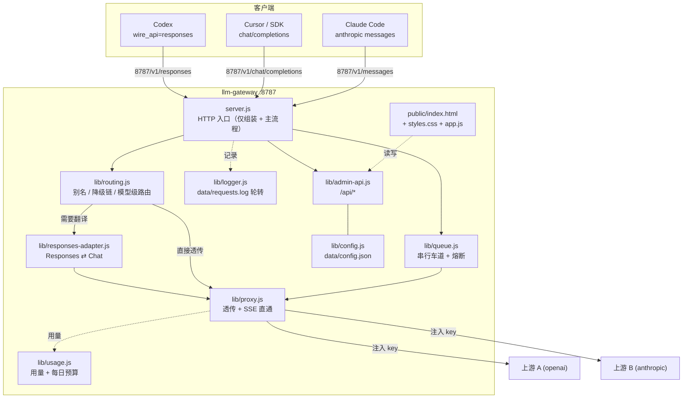

# LLM Gateway · 项目知识图谱（维护手册）

> 面向"接手这个项目的人/AI"。读这一份就够了：它是代码结构与设计决策的索引，
> 而不是使用说明（使用说明见 [README.md](./README.md)）。
>
> **维护纪律**：任何改动都必须同步更新本文件的「变更历史」与相关章节，并提交 git。

- 当前版本：**v1.10.2**（见 `package.json`）
- 仓库：https://github.com/Linix0/llm-gateway （Public / main / MIT）
- 运行时：Node >= 18，**零第三方依赖**（只 `require` 内置模块）
- 本机路径：`C:\Users\Administrator\WorkBuddy\2026-10-22-14-09-51\llm-gateway`

---

## 1. 它解决什么问题

把 Codex / Cursor / Claude Code / 任意 OpenAI 兼容客户端统一指向 `http://127.0.0.1:8787`，
上游用哪家、用哪把 key、用哪个模型，全部在网关上切换，客户端配置一次就不动。

两件别人做不了的事：

1. **协议适配**：Codex 0.16x 只支持 `wire_api="responses"`，而多数中转只有 `/v1/chat/completions`。
   网关实时把 Responses 请求翻译成 chat（含流式事件、工具调用），再把结果翻回 Responses。
2. **模型由网关决定**：客户端传什么模型名都无所谓，实际用哪个模型在网关界面上选。

---

## 2. 架构总览



**关键约束**：只监听 `127.0.0.1`（`config.server.host`）。不代理 WebSocket，不做鉴权，
不要把 host 改成 `0.0.0.0` 后暴露到局域网。

---

## 3. 文件地图

> **v1.10.0 起已模块化**：原先 1589 行的 `server.js` 拆成 `lib/` 九个模块，
> 单文件 1900 行的 `public/index.html` 拆成三个文件。下面两张表是现在的真实结构。

### 后端

| 文件 | 行数级 | 职责 | 改这里要注意 |
|---|---|---|---|
| `server.js` | ~220 | **只做三件事**：`require` 组装模块、HTTP 主流程（路由/静态/降级循环）、优雅退出 | 不要往里塞业务函数；新逻辑一律放 `lib/` |
| `lib/config.js` | ~265 | `DEFAULT_CFG`、归一化（`normalizeAliases/Fallback/Budget/Circuit`）、**`cfg` 单例**、`loadCfg`/`reloadCfg`/`saveCfg`、`resolveKey`/`maskKey` | `reloadCfg()` 是**原地覆盖字段**（`Object.assign(cfg, …)`）而非重新赋值，否则其他模块持有的引用全部失效 |
| `lib/util.js` | ~100 | 无状态工具：`statusKind()`、`localIso()`、`readBody()`、`sendJson()`、`forwardHeaders()`、`MIME`、`serveStatic()` | 这里不能 `require` 配置单例，保持纯函数 |
| `lib/logger.js` | ~70 | `recent` 内存环形数组、JSONL 落盘、`rotateLogs()`、`logRequest()`、`logFiles()` | 字节计数用 `logBytes` getter + `resetLogBytes()` 暴露（`/api/logs/clear` 依赖） |
| `lib/usage.js` | ~150 | **`usage` 单例**、`recordUsage()`、`extractUsage()`、`budgetDayKey/rollToday/budgetState` | `usage` 是共享单例，`/api/usage/clear` **原地清空**（遍历 delete）而不是 `usage = {}` |
| `lib/queue.js` | ~150 | 每 provider 串行车道（`withLane`）、`circuits` 熔断状态、`circuitOpen()`、`noteUpstreamResult()` | `withLane()` **必须 `return await fn()`**，否则调用方拿到 `undefined` 会把成功误判为失败（v1.9.0 真 bug） |
| `lib/routing.js` | ~175 | `isAnthropicPath`/`isModelPath`、`applyAlias`、`resolveFallbackModel`、`buildCandidates`、`pickProvider`、`mapModel`、`resolveTarget`、`listModels` | 别名优先于 `modelPolicy=fixed`（靠第三参 `aliased` 跳过 fixed 分支） |
| `lib/proxy.js` | ~430 | `proxyRequest()`（透传 + SSE）、`handleResponsesProxy()`（Responses 翻译代理）、`sseWrite()` | 两函数所有结束分支都要 `done()`；`opts.softFail` 时不写客户端，只返回 `{ok,status,kind,message}` |
| `lib/tester.js` | ~205 | `testProvider`/`testModel`、**`modelStatusStore` 单例**、`runAutoTest`/`scheduleAutoTest` | 测活结果持久化到 `data/model-status.json`；定时巡检只在上游车道空闲时跑 |
| `lib/admin-api.js` | ~345 | `handleAdmin()`，所有 `/api/*` 端点（大 `if` 链） | 加端点要同步本文件 §6 与 README 的 API 表 |
| `lib/responses-adapter.js` | ~490 | Responses ⇄ chat/completions 双向翻译，导出 `toChatRequest` / `chatToResponses` / `streamChatToResponses` | 改流式事件序列务必用真实 `codex exec` 验证 |

### 前端

| 文件 | 行数级 | 职责 |
|---|---|---|
| `public/index.html` | ~510 | 页面结构：左栏 `.sidebar`（品牌/导航/状态/模型胶囊），右栏 `.main` 五个分页 `.page#page-{overview,providers,policy,snippets,logs}`；`<link rel="stylesheet" href="/styles.css">` + `<script src="/app.js">` |
| `public/styles.css` | ~570 | 全部样式：`:root` / `[data-theme=light]` 双主题变量、侧边导航、卡片折叠、策略页（`.arow`/`.fb-chip`/`.bud-bar`/`.circ-*`）、≤920px 响应式 |
| `public/app.js` | ~1490 | 全部交互：`showPage()`（localStorage + URL hash）、自动刷新、`HELP` 释意映射、`/api/*` 调用与渲染 |

改界面时注意：三个文件由 `serveStatic` 按 MIME 直出，无构建、无缓存头协商；改完硬刷新即可。
新增分页要**同时**加导航项（`data-page`）与 `.page` 段；新增卡片要带 `data-cid` 才接入折叠体系。

### 数据与运维

| 文件 | 职责 |
|---|---|
| `data/config.json` | 运行配置（**gitignore，含明文 key**）。只能由 `saveCfg()` 写，勿手改（会被原子写覆盖） |
| `data/config.example.json` | 脱敏样例，入库。新增配置字段时**必须同步** |
| `data/requests.log[.N]` | JSONL 请求日志，按大小轮转（gitignore） |
| `data/usage.json` / `data/model-status.json` | 用量与测活结果持久化（gitignore） |
| `autostart.ps1` | 注册/启停 Windows 计划任务 `LlmGateway` |
| `start-hidden.vbs` | 由计划任务调用，无窗口启动 node（gitignore，含本机绝对路径） |

### 模块依赖方向（**不要成环**）

```
server.js ──► config / util / logger / usage / queue / routing / proxy / tester / admin-api
config    ──► util                    (纯叶子)
logger    ──► config                  (读 logs 配置)
usage     ──► config + util           (读 budget 配置)
queue     ──► config + util
routing   ──► config + queue          (buildCandidates 要读熔断状态)
proxy     ──► config + util + logger + usage + responses-adapter
tester    ──► config + util + queue + proxy
admin-api ──► config + util + logger + usage + queue + routing + tester
```

`config.js` 是最底层：它只依赖 `util`，**不接受反向依赖**。所有模块拿到的都是同一个 `cfg` 对象引用，
所以任何"重新加载/清空"操作都必须**原地修改**，不能重新赋值变量。

---

## 4. 请求生命周期

1. `createServer` 收到请求 → `trackRequest(res)` 计数在途
2. `/healthz` → 直接返回；`/api/*` → `handleAdmin()`；`GET /v1/models` → `listModels()`（本地声明）
3. `GET` 且非模型路径 → 静态文件（`serveStatic`）
4. 非模型路径 → 404（**不要**把页面请求转发到上游）
5. `applyAlias()`：客户端模型名命中 `aliases` 则替换（别名优先于后面的 fixed 策略）
6. `resolveTarget(clientModel, anthropic, aliased)` 选出 `{provider, model}`：
   - 显式 `providerId/modelId` → 精确命中（`aliased` 为 true 时同）
   - `modelPolicy='fixed'` 且未被别名命中 → 一律用 `cfg.activeModel`
   - `modelPolicy='auto'` → 按客户端模型名找唯一声明者，找不到回落当前
7. `mapModel()` 应用 `models[].upstream` 重映射，并写回请求体
8. **预算检查**：`budgetState()` 超限且 `action='reject'` → 429 `gateway_budget_exceeded`
9. **降级循环**：`buildCandidates()` 按 `fallback.order` 构造候选（跳过熔断中的 provider），
   逐个 `withLane()` 发起；前一跳用 `softFail` 让可降级错误不写客户端，`isDegradable()` 为真才继续下一跳；
   只有最后一跳的错误才真正写给客户端
10. 每跳结束后 `noteUpstreamResult()` 更新熔断计数；成功则记录 `used.hop` 并跳出
11. `/v1/responses` 且 provider 未声明 `upstreamResponses:true` → `handleResponsesProxy()` 走翻译
12. 否则 `proxyRequest()`：注入 `authorization` / `x-api-key`，转发，SSE 直通
13. 结束 → `logRequest()` 写 JSONL（路径/模型/状态/耗时，**不记 prompt 与 key**）→ `recordUsage()` 累计用量

---

## 5. 配置契约（`data/config.json`）

```jsonc
{
  "server": { "host": "127.0.0.1", "port": 8787 },
  "active": "nextapi",              // 当前 provider id
  "activeModel": "deepseek-v4.1-flash",
  "modelPolicy": "fixed",           // fixed=忽略客户端模型名 | auto=跟随客户端
  "logs": { "enabled": true, "maxSizeKB": 2048, "keep": 3 },
  "autoTest": { "enabled": false, "intervalHours": 24 },  // 定时自动测活（1–168h）
  "limits": {
    "queue": true,              // 同 provider 串行排队（并发=1 的上游不再互撞 429）
    "queueTimeoutMs": 120000,   // 排队上限，超出返回 503 gateway_queue_timeout（5000–600000）
    "retry": {                  // 429/5xx/网络错误 的整请求重放，默认关（避免重复计费）
      "enabled": false, "maxAttempts": 2, "backoffMs": 800
    }
  },
  "aliases": {                  // 客户端短名 → 真实目标（优先于 modelPolicy=fixed）
    "fast": "nextapi/deepseek-v4.1-flash",   // 值可写 providerId/modelId（精确）或纯模型名
    "smart": "claude-sonnet-4-5"
  },
  "fallback": {                 // 失败降级链
    "enabled": true,
    "order": ["nextapi", "openrouter"],      // 备用 provider id，按序尝试（不含主）
    "maxHops": 1,                            // 单请求最多降级几次（1–5）
    "onKinds": ["rate", "upstream", "net"],  // 哪些错误类型才降级
    "modelMap": { "openrouter": "openrouter/free" }  // 指定某 provider 降级时用的模型
  },
  "budget": {                   // 每日预算（本地时区每天 resetHour 点开新一天）
    "enabled": false,
    "dailyRequests": 0,         // 0 = 不限制
    "dailyPromptTokens": 0,
    "dailyCompletionTokens": 0,
    "action": "warn",           // warn=只告警 | reject=超限返回 429 gateway_budget_exceeded
    "resetHour": 4
  },
  "circuit": {                  // 熔断（默认开）；状态只在内存，重启清零
    "enabled": true,
    "threshold": 5,             // 连续失败次数
    "cooldownMs": 60000         // 熔断持续时间
  },
  "providers": [{
    "id": "nextapi",
    "name": "NextApi",
    "api": "openai",                // openai | anthropic
    "baseUrl": "https://api.nextapi.store/v1",
    "auth": { "type": "bearer", "value": "env:NEXTAPI_API_KEY" },  // env:VAR 或明文
    "upstreamResponses": false,     // true=上游原生支持 /v1/responses，跳过翻译
    "models": [{ "id": "deepseek-v4.1-flash", "name": "…", "contextWindow": 128000, "upstream": "真实名" }]
  }]
}
```

边界（由 `clampNum` 强制）：`maxSizeKB` 64–524288；`keep` 1–20；
`fallback.maxHops` 1–5（`order` 最多 20 项）；`budget.resetHour` 0–23、`dailyRequests` 0–1e8、
token 两项 0–1e12；`circuit.threshold` 2–100、`cooldownMs` 5000–3600000。
`onKinds` 只接受 `ALL_DEGRADE_KINDS` 内的值，非法项被丢弃（空则回落到默认三项）。
`env:VAR` 从 `process.env` 取，取不到视为空（不会报错，请求会以无 key 发出）。

---

## 6. 管理 API 契约

| 方法 | 路径 | 说明 |
|---|---|---|
| GET | `/healthz` | 健康 + `inFlight` + `shuttingDown` |
| GET | `/api/state` | 配置（key 脱敏）+ `runtime` |
| POST | `/api/providers` | 新增/更新（**key 留空 = 不修改**，别把掩码写回去） |
| DELETE | `/api/providers/{id}` | 删除 |
| POST | `/api/active` | `{"id":"..."}` 切换当前 |
| POST | `/api/test` | 只查 `/models` 列表，**不调用模型** |
| POST | `/api/test/model` | `{"provider","model"}` 真实调用测活 |
| POST | `/api/test/models` | `{"items":[...],"delayMs":1200}` 串行批量测活 |
| GET | `/api/test/status` | 持久化的测活结果 + `autoTest` 配置 |
| POST | `/api/test/auto` | `{"enabled":true,"intervalHours":24}` 定时自动测活 |
| POST | `/api/model` | 设置 `activeModel` |
| POST | `/api/policy` | `{"policy":"fixed"\|"auto"}` |
| GET | `/api/logs?limit=50` | 最近日志 |
| GET | `/api/logs/meta` | 容量 + 文件清单 |
| POST | `/api/logs/config` | 改轮转策略 |
| POST | `/api/logs/clear` | `{"archives":true}` 连归档删 |
| GET | `/api/logs/download?name=` | 下载（只匹配 `requests.log[.N]`） |
| GET | `/api/usage` | 用量：总额 + 按 provider/model 明细（请求数/失败/token/均耗时）。**含今日预算进度的不是这里**，是 `GET /api/state` 的 `budgetState` 字段 |
| POST | `/api/usage/clear` | 用量清零（**原地清空 `usage` 单例**） |
| POST | `/api/reload` | 重读 config.json（**原地覆盖 `cfg` 字段**） |
| GET/POST | `/api/aliases` | 读取/保存模型别名：`{"aliases":{"fast":"nextapi/deepseek-v4.1-flash"}}` |
| GET/POST | `/api/fallback` | 读取/配置降级链（body 见 §5 `fallback`） |
| GET/POST | `/api/budget` | 读取/配置每日预算；`{"resetToday":true}` 清零今日计数 |
| GET/POST | `/api/circuit` | 读取熔断状态/配置；`{"reset":"all"\|providerId}` 手动复位 |

测活 `kind`：`ok` / `rate`(429) / `auth`(401-403) / `missing`(404) / `reject`(400) / `upstream`(5xx) / `net`。

---

## 7. 设计决策与坑（**改动前必读**）

| 决策 | 原因 | 反直觉的地方 |
|---|---|---|
| 零依赖 | 免 `npm install`，拷走即用 | 不要为此引第三方包；要工具函数自己写 |
| 配置/用量/测活是**共享单例** | 各模块 `require` 时拿到的是同一份对象引用 | 因此"重新加载""清零"都必须**原地修改**：`reloadCfg()` 用 `Object.assign(cfg, …)`、`/api/usage/clear` 遍历 `delete`。**一旦改成 `cfg = x` / `usage = {}`，其余模块仍持有旧对象，改动静默失效**（v1.10.0 拆分时踩过） |
| `withLane()` 必须 `return await fn()` | 调用方靠返回值判定成功/失败并喂给熔断 | 漏了 return → 所有请求被记成失败 → 熔断只涨不清 |
| 不做自动重试 | 避免重复计费 | v1.6.0 起改为**默认关、可选开**：只在 429/5xx/网络错误且**尚未给客户端写过任何字节**时整请求重放，一旦开始流式输出绝不重试 |
| 每 provider 串行车道 | 上游普遍"并发=1"，透传会互撞 429 | 车道按 provider 隔离（一个上游卡死不影响别的）；排队中的请求客户端断开会立即取消，不会泄漏车位 |
| `proxyRequest`/`handleResponsesProxy` 返回 Promise | 供 `withLane` 排队与优雅退出感知完成 | **改这两个函数时必须保证所有分支（end/error/close/重试耗尽）都调用 `done()`**，否则车道永久泄漏——v1.6.0 开发中就因往已销毁的 res 写响应抛异常导致 done 不执行，已用 try/finally + `sendJson` 防御修复 |
| 日志不记 prompt/key | 安全 | 排障时只能看路径/状态/耗时 |
| `modelPolicy=fixed` 静默替换模型 | 用户不想在客户端改配置 | 逃生门是 `providerId/modelId` 显式写法 |
| 时间存本地时区 + `at` 毫秒 | 曾存 UTC 导致界面差 8 小时 | 解析用 `at`，不要用 `ts` 再算 |
| 编辑表单 key 留空=不修改 | 曾把 `sk-21a4****` 掩码写回覆盖真实 key | 任何"保存配置"路径都要遵守这条 |
| `reconcileActiveModel()` 必须传参 | 早期版本引用全局 `cfg` 触发 TDZ 崩溃 | 不要在 `loadCfg()` 里读全局 `cfg` |
| `GET /` 曾被当模型请求转发 | 静态判断漏了方法/前缀 | 现在有 `isModelPath()` 兜底 |
| 上游限流 | NextApi 账号为 **RPM=10 / 并发=1** | 密集测试会满屏 429，**不是网关 bug**；批量测活必须串行节流 |

### 环境坑（本机）

- `github.com:443` 全 IP 超时，只有 SSH:22 通 → 推送一律走 `git@github.com:...`，`gh auth login --web` 必失败。
- Git Bash 可能把中文参数按 GBK 编码发出导致上游 400/500 → 测试请求体写成 UTF-8 文件再 `--data-binary @file`。
- 沙箱内：`schtasks.exe` 与 `wscript` 被安全策略拦截；用 PowerShell 的 `Start-ScheduledTask` / `Stop-ScheduledTask`。
- 重启服务正确姿势：`Stop-Process -Id <pid> -Force` 后再 `Start-ScheduledTask -TaskName LlmGateway`
  （只 `Stop-ScheduledTask` 不会结束已运行的进程，pid 不变，新代码不生效）。

---

## 8. 常见维护任务（怎么做）

| 任务 | 做法 |
|---|---|
| 加一个新 provider | 界面「新增」即可；或改 `config.json` 后 `POST /api/reload`。改端口需重启 |
| 加一个管理 API | 在 `lib/admin-api.js` 的 `handleAdmin()` `if` 链里加一段，返回用 `sendJson()`；同步本文件 §6 与 README |
| 加一个界面分区 | 在 `public/index.html` 复制 `.card` 结构并带 `data-cid`（自动接入折叠/持久化）；样式写在 `styles.css` 且用变量；逻辑写在 `app.js`。如需独立成页，在 `#nav` 加 `data-page` 项并放 `.page` 段 |
| 新增加密/鉴权 | 在 `server.js` 的 `createServer` 入口做，注意别拦 `/healthz` |
| 新增后端模块 | 放 `lib/`，只依赖下层模块（见 §3 依赖方向，不要成环）；需要配置就 `require('./config')` 拿 `cfg`，**不要自己再读一次文件** |
| 改 Responses 适配 | 改 `lib/responses-adapter.js`，用真实 `codex exec` 验证（纯对话 + apply_patch 工具调用两条路径） |

### 验证清单（改完必跑）

```bash
node --check server.js && for f in lib/*.js public/app.js; do node --check "$f"; done   # 语法（拆模块后必跑）
curl --noproxy '*' http://127.0.0.1:8787/healthz
curl --noproxy '*' http://127.0.0.1:8787/ -o /dev/null -w '%{http_code}\n'   # 静态首页
curl --noproxy '*' http://127.0.0.1:8787/app.js -o /dev/null -w '%{http_code}\n'
curl --noproxy '*' http://127.0.0.1:8787/styles.css -o /dev/null -w '%{http_code}\n'
curl --noproxy '*' -X POST http://127.0.0.1:8787/v1/chat/completions \
  -H 'content-type: application/json' -H 'authorization: Bearer local' \
  --data-binary @/tmp/req.json             # {"model":"…","messages":[{"role":"user","content":"ping"}],"max_tokens":16}
# ★ Codex 走的是 /v1/responses，必须单独冒烟（v1.10.2 的 P0 就是漏测这条路径）
curl --noproxy '*' -m 40 -X POST http://127.0.0.1:8787/v1/responses \
  -H 'content-type: application/json' -H 'authorization: Bearer local' \
  --data-binary @/tmp/resp.json   # 流式与非流式各测一次，都要有 200 与响应体
curl --noproxy '*' http://127.0.0.1:8787/api/state   # 确认 runtime.lanes 为空（无车道泄漏）
```

拆分后尤其要验证的：`/api/state` 能返回、`/api/reload` 后界面数据仍更新（证明原地覆盖生效）、
`/api/usage/clear` 后再查 `/api/usage` 确实为 0（证明原地清空生效）。

界面用 headless Chrome 截图核对（暗/亮/窄屏三态）：

```
"C:/Program Files/Google/Chrome/Application/chrome.exe" --headless=new --no-proxy-server \
  --window-size=1280,2200 --screenshot=out.png "http://127.0.0.1:8787/?theme=dark"
```

> 截图属内部验证产物，看完即删，不要留在仓库或项目目录。

---

## 9. 变更历史

### v1.10.2 · P0：Codex（/v1/responses）请求全部挂起

**症状**：Codex 发出请求后无限等待，无任何响应；`/api/state` 里该 provider 车道 `running=1` 长期不归零，
后续请求 `queued` 堆积，直到 `queueTimeoutMs`(120s) 才返回 503「排队超时：该上游当前繁忙」。
**只影响 `/v1/responses`**（Codex `wire_api=responses`），`chat/completions` 正常。

**根因**：`lib/proxy.js` 的 `handleResponsesProxy()` 里定义了 `const send = () => {...}`，
但 Promise executor 末尾**漏了 `send()` 调用**（v1.10.0 拆分时丢失；`proxyRequest` 第 196 行有，这里没有）。
结果：请求从不发给上游 → 返回的 Promise 永久 pending → `withLane` 的 `finally releaseLane` 永远不执行
→ 车道被永久占用。**客户端断开也不会释放**（因为 `res.on('close') → done()` 依赖 send 分支里注册的监听器）。

**修复**：executor 末尾加 `send();`（与 proxyRequest 对称）。

**排障方法（可复用）**：
1. `GET /api/state` 看 `runtime.lanes`：某 provider 长期 `running>=1` 且 `queued` 增长 = 车道卡死。
2. 先直连上游验证上游健康（排除上游问题），再查网关侧。
3. 日志默认写于请求结束时，**挂起的请求不产生日志**——排障前先 `POST /api/logs/config {"enabled":true}`。
4. 修这类"永不响应"的 bug 时，优先比对 `proxyRequest` 与 `handleResponsesProxy` 两个函数的结构对称性。

**教训**：拆分后只做了 chat/completions 与别名的端到端冒烟，**没有覆盖 `/v1/responses`**——
而 Codex 恰恰走这条路径。验证清单已补上两条 responses 冒烟（流式 + 非流式）。

### v1.10.1 · 策略页下拉化与卡片密度治理（纯前端，无 API 变更）

- **模型别名改下拉**：`addAliasRow()` 从「别名 + 手填目标」两列改为「别名输入 + 供应商下拉 +
  模型下拉」三控件联动。新增 `modelIdsOf()` / `providerOptions()` / `modelOptions()` / `splitTarget()`
  四个辅助函数；供应商选「按模型名自动匹配」时模型下拉列全库去重模型（存纯模型名），
  选了供应商则列该供应商模型（存 `providerId/modelId`）。改任何行会置「未保存」提示（`markAliasDirty()`）。
- **降级 modelMap 改下拉**：`renderFbModelMap()` 的模型输入框改为 `select`（空值="自动选择"），
  保存逻辑 `#fbModelMap .fbmap` 不变（select.value 兼容）。
- **卡片密度治理**（根因：策略页四张卡 `card-body` 无 padding，内容贴边）：
  四卡 body 加 `pad` 类且 `.card-body.pad` 提到 `16px 18px`；新增 `.psec` 分块间距（18px）取代散落的
  inline margin；`.row`/`.arow`/`label.f`/`.kinds`/`.fb-chip`/`.circ-*` 间距全部放宽；
  `card-body.pad .actions` 通栏贴底（负 margin 抵消 padding）。
- **select 自绘下拉箭头**：`appearance:none` 后 select 视觉上像输入框，用双 linear-gradient 画箭头
  并 `padding-right:28px`，全局生效。
- **窄屏防御**：`.arow` ≤700px 时别名/供应商各自独占一行；`.circ-item` 子项 `min-width:0` +
  错误文案 ellipsis（"排队超时：…"这类长文案不再有撑破风险）。
- **验证方法**：同源探针页（`public/_probe.html`，iframe 加载目标页后枚举 `getBoundingClientRect().right`
  超出 `clientWidth` 的元素）定位横向溢出，验证后即删——430px 视口确认无页面级溢出，
  只有顶部导航项在自身滚动容器内超出（预期）。
- 策略页测试残留（aliases fast/smart、fallback、budget）已通过 `/api/*` 复位为默认；
  熔断里 openrouter 的失败计数是正常业务流量（排队超时），非测试数据。

### v1.10.0 · 模块化拆分（1589 行单文件 → `lib/` 九模块 + `public/` 三文件）

纯结构性重构，**行为不变**（配置格式、API 契约、界面功能全部兼容）。

- **后端**：`server.js` 从 1589 行降到 ~220 行，只保留「组装模块 + HTTP 主流程 + 优雅退出」。
  拆出 `lib/config.js`（配置单例与归一化）、`lib/util.js`（无状态工具）、`lib/logger.js`、
  `lib/usage.js`、`lib/queue.js`（车道+熔断）、`lib/routing.js`（别名/降级/解析）、
  `lib/proxy.js`、`lib/tester.js`、`lib/admin-api.js`；`lib/responses-adapter.js` 原地不动。
  依赖方向严格单向（见 §3）：`config` 是叶子之上第一层，任何模块都不反向依赖入口。
- **前端**：`public/index.html` 从 ~1900 行降到 ~510 行，`<style>` → `styles.css`（~570 行），
  `<script>` → `app.js`（~1490 行）机械抽出，无构建、无打包。
- **拆分引入的两个陷阱（已修，改代码务必遵守）**：
  1. `cfg` / `usage` / `modelStatusStore` 都是**跨模块共享单例**，`require` 拿到的是引用。
     所以 `reloadCfg()` 改为 `Object.assign(cfg, …)` 原地覆盖，`/api/usage/clear` 改为
     遍历 `delete` 原地清空——写成重新赋值会让其他模块继续持有旧对象，改了不生效。
  2. `logBytes` 是模块内私有的，跨模块重置需要显式 `resetLogBytes()`，`/api/logs/clear` 已改为调它。
- **验证**：全部 `node --check` 通过；重启后 v1.9.0 功能照常——别名 `fast` → nextapi 200/1.8s、
  `/v1/models` 8 个模型、`/api/usage` 50 次记录、nextapi 测活 ok 1552ms、
  `/`、`/app.js`、`/styles.css` 均 200。

### v1.9.0 · 模型别名、失败降级、每日预算与熔断

新增四个策略段，都在管理界面「策略」页（第五个分页）配置：

- **模型别名** `aliases`：客户端写短名（如 `fast`）→ 网关联到真实模型。
  `applyAlias()` 在路由前替换；**别名优先于「网关固定」策略**（管理员显式定义的语义路由），
  `resolveTarget(clientModel, anthropic, aliased)` 第三个参数为 true 时跳过 fixed 分支。
  目标可写 `providerId/modelId`（精确）或纯模型名。
- **失败降级** `fallback`：主 provider 失败时按 `order` 链换备用重试。
  `buildCandidates(primary, explicit)` 构造候选列表；`proxyRequest`/`handleResponsesProxy`
  新增 `opts.softFail`——可降级错误（429/5xx/网络，即 `DEGRADABLE_KINDS`∩`onKinds`）不写客户端，
  只把 `{ok,status,kind,message}` 返回给降级链。模型名解析：仅「原本选定的 provider」沿用原名，
  其余（含主熔断让位后的新主）走 `resolveFallbackModel()`：同名 → `modelMap` → 第一个模型。
  客户端显式 `providerId/modelId` 时永不降级。
- **每日预算** `budget`：`usage.json` 新增 `today` 字段（本地时区 `resetHour` 点开新一天），
  转发前 `budgetState()` 检查，`action=reject` 且超限返回 429 `gateway_budget_exceeded`。
- **熔断** `circuit`（默认开）：`noteUpstreamResult()` 按 provider 累计连续失败，到阈值后
  `openUntil = now + cooldownMs`；熔断中的 provider 被 `buildCandidates` 跳过（含主 provider 让位）。
  `POST /api/circuit {"reset":"all"|providerId}` 手动复位。熔断状态只在内存，重启清零。

**开发中实测抓到的两个真 bug**：

1. `withLane()` 没有 `return await fn()`，导致降级链/熔断拿到 `undefined`，所有请求都被记成失败——
   表现为熔断计数只涨不清。修复：必须返回 fn 的结果。
2. 主 provider 被熔断跳过后，模型名仍按主 provider 的视角解析（`i === 0` 判断），把 nextapi 没有的
   模型名发过去 → 上游 403。修复：改为按「p 是否为 picked.provider」判断。

实测：别名 `fast` 在 fixed 策略下正确路由到 nextapi；agentrouter（不可达）→ nextapi 降级 200；
熔断 threshold=2 后第三次请求直接跳过 agentrouter（7s → 1.4s）；预算 reject 超限返回 429。

### v1.8.0 · 侧边导航布局、功能释意与 README 规范化

- **界面重构**：顶部栏 + 单页堆叠卡片 → 侧边导航布局。左栏 `.sidebar`（品牌、导航、状态、模型胶囊、
  版本信息），右栏 `.main` 占满视口，四个分页：总览（当前调用模型 + 用量统计）、供应商（列表 + 编辑器）、
  客户端接入、请求日志。`showPage(id)` 切换，localStorage + URL hash（`#providers` 等）记忆，支持深链接。
- **功能释意**：卡片/区块标题旁新增 `.help-btn`（?），点击弹出 `.help-pop` 浮层解释该功能；
  内容在 `HELP` 映射里（route/providers/editor/models/snippets/usage/logs 共 7 条）。
- 布局细节：供应商列表不再限高（`max-height:none`）；日志表 `max-height: calc(100vh-250px)` 撑满视口；
  内容区 max-width 1240px；≤920px 时侧边栏变顶部横排导航（`.nav` 可横向滚动）。
- 移除「全部折叠」按钮（分页后不再需要）；默认折叠集不再含 snip（接入页独占一屏，进入时强制展开）。
- **README 重写为开源项目规范**：去掉本机专属内容（"当前机器上的配置"、具体模型清单、本机路径），
  改为 特性/快速开始/接入客户端/配置/自启/API/项目结构/已知限制/License 结构，补 shields 徽章。

### v1.7.0 · 测活结果持久化与定时自动测活

- `recordModelStatus()`：每次测活结果落盘 `data/model-status.json`（3s 合并原子写）；
  `GET /api/test/status` 返回，界面启动时回填，重启后 chip 仍有着色。
- **定时自动测活**（`autoTest.enabled`，默认关）：每 `intervalHours`（默认 24h）把全部模型
  串行测一遍（1.2s 节流），**对应上游车道正忙时跳过**，不打扰正常流量；
  启动后 90s 先跑一次。界面供应商卡片底部有「定时测活」开关；`POST /api/test/auto`。
- 实测：自动测活一轮 9 模型全部入账（nextapi 5 OK / agentrouter 3 net / openrouter 1 OK）。

### v1.6.0 · 请求队列与可选重试

- **每 provider 串行车道**（`limits.queue`，默认开）：同 provider 的上游请求排队执行，
  并发=1 的上游（如 NextApi 免费档）不再互撞 429；不同 provider 车道互不影响。
- 排队上限 `limits.queueTimeoutMs`（默认 120s），超出返回 503 `gateway_queue_timeout`；
  排队期间客户端断开立即取消，不占车位。
- **可选重试** `limits.retry`（默认关）：仅当 429/5xx/网络错误且**尚未给客户端写过任何字节**
  时整请求重放（`backoffMs × attempt` 退避）；开始流式输出后绝不重试；客户端断开取消重试。
- `proxyRequest()` / `handleResponsesProxy()` 改为返回完成 Promise；所有结束分支调用 `done()`。
- 防御修复：`sendJson()` 对已销毁响应直接返回（曾因往断开的 res 写 502 抛异常，
  导致车道不释放——这是开发本版本时实测抓到的死锁）。
- `/api/state` 暴露 `limits` 与实时 `lanes`（每个 provider 的 running/queued）。
- 实测：并发 2 请求 → 1.5s / 2.86s 双 200（改造前第二个必 429）；
  断开释放 → lanes 立即清空；重试 → agentrouter 连接失败重放 2 次后 502。

### v1.5.0 · 用量统计

- `recordUsage()`：每个代理请求（成功/失败）按 `provider||model` 累计请求数、失败数、token、耗时。
- `extractUsage()`：非流式取整个 JSON 的 `usage`；流式只保留响应**尾部 8KB** 用正则抠最后一个
  `usage` 片段（usage 只出现在最后一个 chunk）。OpenAI（`prompt_tokens`）与
  Anthropic（`input_tokens`）字段名都兼容。
- 插桩点：`proxyRequest()`（通用透传）、`handleResponsesProxy()`（非流式 + 流式的最后 chunk）、
  两处上游错误分支。`proxyRequest` 由 `pipe` 改为手动 `write/end` 以便采集，**注意**此后
  每个响应都会经过这层，改 SSE 时要保留直通语义。
- 持久化 `data/usage.json`（原子写，5s 合并）；`GET /api/usage`、`POST /api/usage/clear`。
- 界面新增「用量统计」卡片（`data-cid="usage"`）：总额格子 + 明细表，随自动刷新更新。

### v1.4.1 · 配置原子写与优雅退出

- `saveCfg()`：`writeFileSync` 直接覆盖 → **tmp → 复制 .bak → rename**。中途崩溃不再留下半个 config.json。
- 新增 `trackRequest()` 与 `inFlight` 计数；`/healthz` 暴露 `inFlight` / `shuttingDown`。
- 新增 `shutdown(sig)`：收到 SIGINT/SIGTERM 后 `server.close()` 停收新请求，
  等在途请求完成（最多 15s）再退出；期间的新请求返回 503 `gateway_shutting_down`。
  （原先直接 `process.exit(0)`，会硬断流式响应。）
- `.gitignore` 增加 `data/config.json.bak` / `.tmp`。

### v1.4.0 · 模型级真实测活

- `testModel()`：`max_tokens=1` 真实调用；`kind` 分类（429 单列为 `rate`，不误报失败）。
- `POST /api/test/model`、`POST /api/test/models`（串行 + `delayMs` 节流）。
- 界面：模型行「⚡」+ 状态列；「测活全部模型」「测所有模型」；供应商列表模型 chip 着色。

### v1.3.0 · 界面简洁化与日志轮转

- 四分区折叠 + 状态持久化；日志时间改本地时区；按大小轮转 + `keep` 归档；
  `/api/logs/meta|config|clear|download`；`isModelPath()` 兜底；修浅色按钮白底白字与窄屏溢出。

### v1.2.0 · 模型由网关决定

- `activeModel` + `modelPolicy`；`POST /api/model`、`POST /api/policy`；`providerId/modelId` 逃生门。

### v1.1.0 · 管理界面改版

- 双主题、模型行编辑器、接入片段、脏标记、修掩码 key 回写 bug。

### v1.0.0 · 首个可用版本

- 多 provider、OpenAI/Anthropic 透传、Responses⇄chat 适配、后台常驻 + 开机自启。
